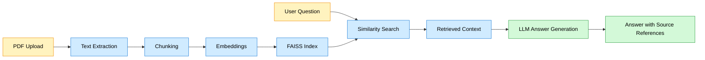

# Domain-Specific RAG Chatbot for PDF Question Answering

## Overview
This project builds a domain-specific Retrieval-Augmented Generation (RAG) app for PDF question answering. It allows users to upload PDF files, extract text, split the content into chunks, embed the chunks using a sentence-transformer model, and use a FAISS vector store for similarity search. The retrieved passages are then sent to a Groq-hosted language model to answer questions while keeping source references to the original document and page number.

## Problem Statement
Organizations often store operational knowledge in PDFs such as policy manuals, product documents, internal guides, and training material. Searching manually across many PDFs is slow and error-prone. This project demonstrates a beginner-friendly RAG workflow that can answer natural-language questions using uploaded document content while grounding the answer in source evidence.

## Objectives
- Upload one or more PDF files in a Streamlit app.
- Extract and validate PDF text safely.
- Chunk content while preserving filename and page metadata.
- Embed and index text with FAISS for retrieval.
- Use Groq for answer generation with source-grounded prompting.
- Return answers that cite source document names and page numbers.
- Refuse unsupported questions and avoid inventing facts.

## Key Features
- Multi-file PDF upload with 20 MB per-file validation.
- Safe handling for malformed, encrypted, and unreadable PDFs.
- Chunking and metadata tracking for source document and page number.
- Embeddings using sentence-transformers/all-MiniLM-L6-v2.
- FAISS vector retrieval with caching and persistence support.
- Responsible AI system prompt with refusal behavior.
- Streamlit chat UI with document and chat controls.
- Automated tests for document extraction, indexing, and answer generation.

## Technology Stack
- Python 3.11
- Streamlit
- pypdf
- LangChain text splitters
- sentence-transformers
- faiss-cpu
- Groq API
- python-dotenv
- pytest
- reportlab (for local PDF test fixtures)

## Architecture and Workflow
The app separates document indexing from question answering:

1. Users upload PDFs in the Streamlit app.
2. The document loader validates and extracts text from each page.
3. Content is split into chunks with source metadata preserved.
4. Embeddings are generated with the all-MiniLM-L6-v2 model.
5. FAISS stores normalized embeddings in an `IndexFlatIP` index; its inner-product scores are cosine similarities used to rank and filter passages.
6. User questions are embedded and queried against the index.
7. Relevant chunks are sent to the LLM along with a strict system prompt.
8. The app returns an answer and the associated document source references.

## Folder Structure
```text
Domain-Specific RAG Chatbot for PDF Question Answering/
├── app.py
├── document_loader.py
├── vector_store.py
├── rag_pipeline.py
├── prompt.py
├── requirements.txt
├── README.md
├── .env.example
├── .gitignore
├── documents/
│   └── .gitkeep                 # uploaded/private documents stay local
├── vector_store/
│   └── .gitkeep                 # generated FAISS files stay local
├── tests/
│   ├── test_document_loader.py
│   ├── test_vector_store.py
│   ├── test_rag_pipeline.py
│   └── test_questions.csv
└── .venv/    # local virtual environment, not committed
```

Uploaded PDFs are processed in memory and are not saved by the application.
The `documents/` folder is for local files only; PDFs and other common personal
documents are excluded from Git by default. Do not add private documents,
credentials, or generated vector indexes to a public repository.

## Prerequisites
- Python 3.11 installed.
- VS Code with Python extension installed.
- Internet access for the first model download.
- A Groq API key for live generation.

## Windows VS Code Installation Instructions
1. Open VS Code.
2. Open the project folder: `c:\Users\NIHARIKA\OneDrive\Desktop\Domain-Specific RAG Chatbot for PDF Question Answering`.
3. Open a terminal inside VS Code.
4. Create a virtual environment:
   ```powershell
   python -m venv .venv
   ```
5. Activate it:
   ```powershell
   .\.venv\Scripts\Activate.ps1
   ```
6. Install dependencies:
   ```powershell
   python -m pip install --upgrade pip
   python -m pip install -r requirements.txt
   ```

## Environment Variable Setup
Create a local `.env` file in the project folder using `.env.example` as a
template. Set `GROQ_API_KEY` to your own key and keep the file local:

```env
GROQ_API_KEY=your_groq_api_key_here
GROQ_MODEL=openai/gpt-oss-20b
```

Important:
- Replace the placeholder with a key obtained from Groq; never paste the key
  into Python source code, README files, chat messages, or screenshots.
- `.env` is ignored by Git. Do not force-add it or share it.
- `.env.example` contains variable names and placeholders only; it is safe to
  commit.
- The first embedding model download requires internet access.

## Running the Application
From the project root:

```powershell
python -m venv .venv
.\.venv\Scripts\Activate.ps1
python -m pip install -r requirements.txt
python -m streamlit run app.py
```

Then open the displayed local URL in your browser.

## Testing
Run the automated tests from the project root:

```powershell
.\.venv\Scripts\Activate.ps1
python -m pytest -v
```

This project includes tests for:
- PDF text extraction
- Metadata preservation
- Empty pages and no-text PDFs
- Chunking behavior
- FAISS indexing and retrieval
- RAG answer formats and fallback paths
- LLM error handling without fabricated answers

## Example Questions
Use questions such as:
- What does the document say about compliance?
- Which page contains the refund policy?
- Who is listed as the point of contact?
- Are there any instructions about remote work?
- What are the main deadlines or obligations described in the PDF?

## Troubleshooting
- Model download fails: check internet access and firewall settings.
- Streamlit says app failed to start: verify dependencies are installed in the active virtual environment.
- PDF is not processed: ensure the file is a valid PDF under 20 MB.
- Scanned PDFs may contain no extractable text because OCR is not implemented.
- Empty answer: the document content may be missing, or the retriever may not find relevant passages.
- Groq API errors: check the `.env` file and model name.

## Security Precautions
- Use `.env` locally, never commit secrets.
- Treat uploaded PDF contents as untrusted input.
- Reject unsupported file types and oversized documents.
- Avoid unsafe deserialization and do not load arbitrary serialized files.
- Clearly label generated answers as likely needing verification against the original document.

## Known Limitations
- Retrieval quality depends on the uploaded document content and chunking choices.
- Similarity scores are not calibrated probabilities and cannot prove that a generated answer is supported by a document.
- The LLM is instructed to refuse unsupported questions, but may still hallucinate when the prompt or model is misconfigured.
- OCR is not implemented; some scanned PDFs may need OCR before reliable text extraction.

## Future Enhancements
- Add OCR support for scanned PDFs.
- Save and resume vector indexes between sessions.
- Add PDF page thumbnails and clickable citations.
- Support long-term memory and conversation context.
- Add multilingual document support.

## GitHub Upload Instructions
First create an empty repository on GitHub. Do not add a README, license, or
`.gitignore` there, because this project already has local files for those.
Then run these commands in PowerShell from the project folder. Replace the
example URL with your own GitHub repository URL:

```powershell
git init
git branch -M main
git status --short
git add .
git status --short
git diff --cached --stat
git diff --cached --check
git diff --cached --name-only
```

Review the staged file list and summary. Confirm `.env`, PDFs, personal
documents, `.venv`, and generated vector-store files are not listed before
committing. Do not force-add ignored files.

```powershell
git commit -m "Prepare PDF question-answering chatbot"
$GitHubUrl = "https://github.com/YOUR_USERNAME/YOUR_REPOSITORY.git"
git remote add origin $GitHubUrl
git remote -v
git push -u origin main
```

If Git asks for your identity, configure it with the name and email you want
shown on commits:

```powershell
git config user.name "Your Name"
git config user.email "you@example.com"
```

Do not put passwords, access tokens, or API keys in the remote URL or Git
configuration.

## Deployment Instructions for Streamlit Community Cloud
1. Push the repository to GitHub.
2. Go to Streamlit Community Cloud.
3. Create a new app from the GitHub repository.
4. Choose the project root and the file `app.py`.
5. Add the required environment variable `GROQ_API_KEY`.
6. Set `GROQ_MODEL` to a valid Groq model name.
7. Deploy and test the app with sample PDFs.

## Architecture Diagram


## Manual Evaluation Procedure
Use a small set of example PDFs and run the app to evaluate the following:

1. Retrieval accuracy: check whether the correct PDF and page are returned.
2. Answer correctness: see if the answer matches the document content.
3. Groundedness: confirm the answer is supported by retrieved context.
4. Refusal quality: test questions with no answer in the document.
5. Response time: record time from question input to final answer.

The CSV file `tests/test_questions.csv` provides a starter evaluation dataset with illustrative examples. Adjust the expected page and source values to match the actual document collection used in your evaluation.

## Known Limitations and Manual Setup
- The first runtime may download the embedding model; this requires internet access.
- Some PDFs may need OCR before reliable text extraction is possible.
- Groq API usage requires a valid API key and may incur usage costs.
- Local `.env` values should never be committed to version control.

## Summary
This project demonstrates a complete, working, beginner-friendly RAG workflow for PDF question answering. It is designed to be easy to understand, easy to extend, and suitable for student projects, demos, and proof-of-concept applications.
